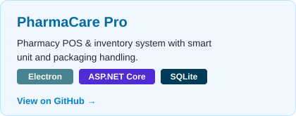
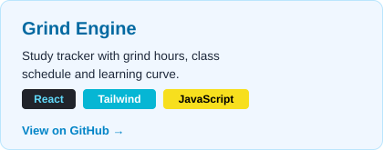

<!-- ===================== HERO ===================== -->

  
  
  
  

## 👨‍💻  About Me

- 🎓 BS Computer Science student at **UET Lahore**
- ⚙️ Building with **ASP.NET Core**, **Next.js**, **C#** and **Python**
- 🧠 Into **DSA**, **REST APIs** and **relational databases**
- 🎯 Looking for a **software engineering internship**

> *A clean data structure beats 500 lines of spaghetti code.*

### 🛠️ Tech Stack & Core Tools

<table width="100%">
  <tr>
    <td width="50%" valign="top">
      <h4>💻 Languages & Backend</h4>
      

        
        
        
        
        
        
      

    </td>
    <td width="50%" valign="top">
      <h4>🎨 Frontend & Desktop</h4>
      

        
        
        
        
      

    </td>
  </tr>
  <tr>
    <td width="50%" valign="top">
      <h4>🗄️ Databases</h4>
      

        
        
        
        
      

    </td>
    <td width="50%" valign="top">
      <h4>⚙️ DevOps & Design Tools</h4>
      

        
        
        
        
      

    </td>
  </tr>
</table>
## 🚀 Featured Projects

<!-- Same 420x165 card size as the analytics cards below -->

  
  

## 📊   GitHub Analytics

<!-- Both cards use the same 420x165 size and each fills half the page width, matching the project columns above -->

  
  

  

<picture>
  <source media="(prefers-color-scheme: dark)" srcset="https://raw.githubusercontent.com/alisher-devtech/alisher-devtech/output/github-snake-dark.svg" />
  <source media="(prefers-color-scheme: light)" srcset="https://raw.githubusercontent.com/alisher-devtech/alisher-devtech/output/github-snake.svg" />
  
</picture>

## 🌐 Let's Connect

Ask me about: ASP.NET Core · Next.js · DSA · Database design

  

**"First, solve the problem. Then, write the code."** — *John Johnson*

