<!-- ===================== HERO ===================== -->

  
  
  
  

## 👨‍💻 About Me

- 🎓 BS Computer Science student at **UET Lahore**
- ⚙️ Building with **ASP.NET Core**, **Next.js**, **C#** and **Python**
- 🧠 Into **DSA**, **REST APIs** and **relational databases**
- 🎯 Looking for a **software engineering internship**

> *A clean data structure beats 500 lines of spaghetti code.*

## 🛠️ Tech Arsenal

<table>
  <tr>
    <td><b>Languages</b></td>
    <td></td>
  </tr>
  <tr>
    <td><b>Frameworks</b></td>
    <td></td>
  </tr>
  <tr>
    <td><b>Databases</b></td>
    <td></td>
  </tr>
  <tr>
    <td><b>Tools</b></td>
    <td></td>
  </tr>
</table>

## 🚀 Featured Projects

<table>
  <tr>
    <td width="50%" valign="top">
      <b>💊 PharmaCare Pro</b> 
      Pharmacy POS &amp; inventory system with smart unit and packaging handling.  
      
      
      
        
      <a href="https://github.com/alisher-devtech?tab=repositories">View on GitHub →</a>
    </td>
    <td width="50%" valign="top">
      <b>📚 Grind Engine</b> 
      Study tracker with grind hours, class schedule and learning curve.  
      
      
      
        
      <a href="https://github.com/alisher-devtech?tab=repositories">View on GitHub →</a>
    </td>
  </tr>
</table>

## 📊 GitHub Analytics

<!-- All three cards are sized to the same 419 x 165 box -->

 

<picture>
  <source media="(prefers-color-scheme: dark)" srcset="https://raw.githubusercontent.com/alisher-devtech/alisher-devtech/output/github-snake-dark.svg" />
  <source media="(prefers-color-scheme: light)" srcset="https://raw.githubusercontent.com/alisher-devtech/alisher-devtech/output/github-snake.svg" />
  
</picture>

## 🌐 Let's Connect

Ask me about: ASP.NET Core · Next.js · DSA · Database design

  

**"First, solve the problem. Then, write the code."** — *John Johnson*

